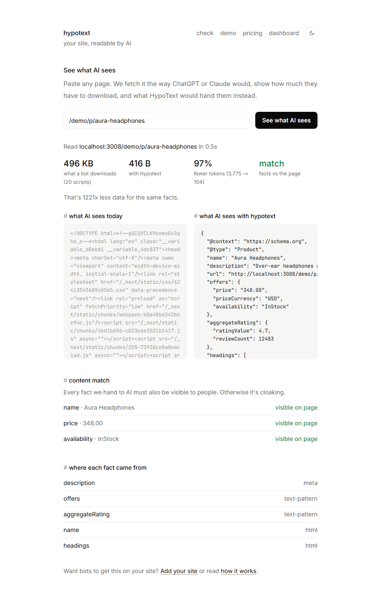
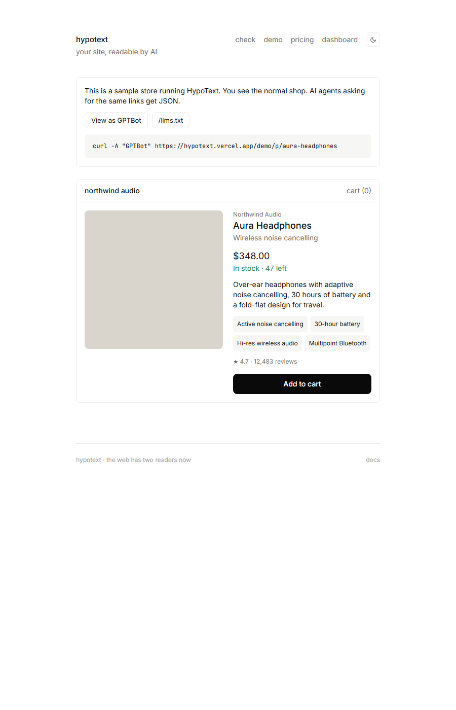
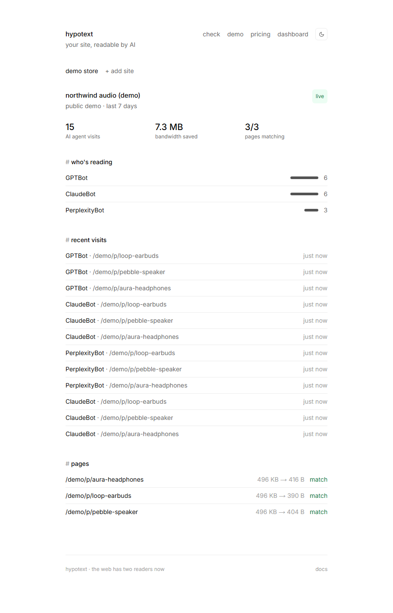

# HypoText

**Your site, readable by AI.** People get your normal pages. AI agents like ChatGPT, Claude and Perplexity get a small, accurate JSON version of the same page, from the same URL.

```bash
curl https://hypotext.vercel.app/demo/p/aura-headphones                # people: ~500 KB of HTML, JS and CSS
curl -A "GPTBot" https://hypotext.vercel.app/demo/p/aura-headphones    # AI: ~400 bytes of JSON
```

```json
{
  "@context": "https://schema.org",
  "@type": "Product",
  "name": "Aura Headphones",
  "description": "Over-ear headphones with adaptive noise cancelling, 30 hours of battery and a fold-flat design for travel.",
  "offers": { "price": "348.00", "priceCurrency": "USD", "availability": "InStock" },
  "aggregateRating": { "ratingValue": 4.7, "reviewCount": 12483 }
}
```

## Overview

About half of web traffic is now AI agents. They don't need pixels, they need facts. On a modern JavaScript site, an agent downloads megabytes of code to find one price, burns tokens on markup, and often gets the price or stock wrong. The common fixes (blocking bots, building a separate API, adding schema tags by hand) either make you invisible to AI or take months.

HypoText is a layer in front of your site. It recognises AI agents, reads your rendered page, pulls out the facts, checks that people can see those same facts, and returns them as schema.org JSON. People see no change.

## Walkthrough

**1. See what AI sees.** Paste any URL. HypoText fetches it the way a bot would and shows what the bot downloads, the JSON it would get instead, the token saving, a content match and which rule produced each fact.



**2. Try the demo store.** A sample shop runs behind HypoText. Browse it normally, then press *View as GPTBot* or `curl` it with a bot user agent. It also serves `/demo/llms.txt`.



**3. Watch the dashboard.** Every AI visit is logged: who's reading, which pages, bandwidth saved, and whether each page's facts match what people see.



## Workflow

```
request → your site → @hypotext/next middleware
                          │
        person ───────────┴─────────── AI agent (GPTBot, ClaudeBot, …)
          │                                   │
   your normal page                 /api/v1/serve
                                      1. reuse JSON if read < 60s ago
                                      2. else fetch the live page (bypass header)
                                      3. extract facts (rules below)
                                      4. content match: are they visible?
                                      5. log the visit
                                    match → 200 JSON
                                    no match / error → bot gets normal page
```

Facts are extracted with rules only, in priority order: existing **JSON-LD**, then **OpenGraph/meta** tags, then **microdata**, then **text patterns** for price, currency, stock and rating near the main heading, then **title, headings and opening text**.

## How to use it

1. Open **Dashboard** and add your domain. You get a site key. No account: the key is stored in a secure cookie on your browser.
2. Add the key to your environment as `HYPOTEXT_KEY`, then create `middleware.ts`:
   ```ts
   import { hypotext } from "@hypotext/next";
   export default hypotext({ siteKey: process.env.HYPOTEXT_KEY! });
   ```
3. Deploy, then press **Check install**, or run `curl -A GPTBot https://yoursite.com`.
4. Add `?view=ai` to any page to preview the AI version in your browser.

Not on Next.js? Call `GET /api/v1/serve?key=…&url=…&bot=…` from any edge or proxy (a Cloudflare Worker example is in `/docs`).

## Best features

- **Same URL, two answers.** People get your page and agents get JSON. There are no separate endpoints for agents to discover.
- **No code changes.** HypoText reads your rendered page, so any stack works and nothing needs rebuilding.
- **Live, not snapshots.** Pages are re-read at most once a minute, so prices and stock stay current.
- **Cloaking-safe.** Every fact served is checked against the visible page. Mismatches are held back.
- **Fails open.** If HypoText is slow or down, bots get your normal page.
- **Explainable.** Every field shows which rule produced it.
- **`llms.txt` for free.** You get a plain-text site map for agents.
- **Bot analytics.** See who's reading, what, and how much bandwidth you saved.

## Limitations

- Bots are recognised by user agent only. A bot that pretends to be a browser isn't caught (no TLS fingerprinting or IP verification yet).
- Extraction is rules-based. Pages with no structured data and unusual layouts give thinner JSON (title, headings, summary). An LLM fallback could fill those gaps later.
- The content match covers name, price and stock, not every field.
- Pages that render all their content in the browser (no server HTML) can't be read yet. There's no headless browser.
- The first bot request to a page waits for one live fetch (usually under 1 second). Later requests are cached for 60 seconds.
- Plans are shown but billing isn't wired up. Sites are tied to a browser cookie, not a user account.

## Run locally

```bash
npm install
npm run dev            # http://localhost:3000
```

Storage is in-memory by default. Set `DATABASE_URL` (Postgres, for example Neon) to persist sites, pages and visits; tables are created on first use. `NEXT_PUBLIC_SITE_URL` sets the origin shown in examples.

## Stack

Next.js 15 (App Router, middleware), TypeScript, Tailwind CSS 4, cheerio, Neon Postgres. The middleware package lives in [`packages/next`](packages/next).
