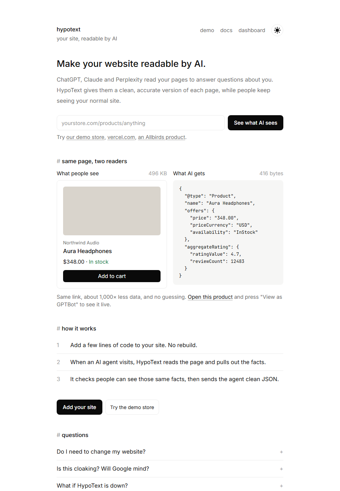

# HypoText

**Make your website readable by AI.** ChatGPT, Claude and Perplexity read web pages to answer questions. HypoText gives them a clean, accurate version of each page, while people keep seeing your normal site. Same link, two answers.



## Overview

About half of web traffic is now AI agents. They don't need pixels, they need facts. On a modern JavaScript site, an agent downloads hundreds of kilobytes of code to find one price, burns tokens on markup, and often gets the price or stock wrong. The usual fixes either make a site invisible to AI (blocking bots) or take months (building a separate API).

HypoText sits in front of a website. When an AI agent asks for a page, HypoText reads that page, pulls out the facts (name, price, stock, rating, description), checks that people can see those same facts, and sends them back as a small schema.org JSON document. People see no change.

On the demo product, that's **633 KB for a person versus 428 bytes for an AI agent**, about 1,500 times less data for the same facts.

## Walkthrough

**1. See what AI sees.** Paste any page link on the home page. HypoText fetches it the way a bot would and shows how much the bot has to download, the JSON it would get instead, the tokens saved, whether the facts match the visible page, and which rule found each fact.


**2. Try the demo store.** Open *demo* in the menu. It's a small shop running behind HypoText. Open any product and press **View as GPTBot** to see exactly what an AI agent receives for that same page. The store also has an AI site map at `/demo/llms.txt`.


**3. Watch the dashboard.** Open *dashboard* → *demo store*. Every AI visit is logged: which agents are reading, which pages, how much bandwidth was saved, and whether each page's facts match what people see.


## Workflow

```
visitor → website → HypoText middleware
                         │
       person ───────────┴─────────── AI agent (GPTBot, ClaudeBot, …)
         │                                   │
  normal page                      1. reuse the JSON if read in the last minute
                                   2. otherwise read the live page
                                   3. pull out the facts
                                   4. check the facts are visible to people
                                   5. log the visit
                                   facts match  → clean JSON
                                   no match     → normal page
```

Facts are found with fixed rules, no AI model, in this order: structured data already on the page (JSON-LD), then OpenGraph and meta tags, then microdata, then price, stock and rating text near the main heading, then the title, headings and opening paragraphs.

## How to use it

1. Open **dashboard** and add your domain. You get a site key. There's no account: the key is remembered in a secure cookie on your browser.
2. Add the key to your environment as `HYPOTEXT_KEY` and add this file to your Next.js app:
   ```ts
   // middleware.ts
   import { hypotext } from "@hypotext/next";
   export default hypotext({ siteKey: process.env.HYPOTEXT_KEY! });
   ```
3. Deploy, then press **Check install** on the dashboard.
4. Add `?view=ai` to any page in your browser to see what AI agents get. From a terminal, you can also pretend to be GPTBot:
   ```bash
   curl -A "GPTBot" https://yoursite.com/any-page
   ```

Not on Next.js? Any server or edge function can call `GET /api/v1/serve?key=…&url=…&bot=…` when an AI agent visits.

## Best features

- **Same link, two answers.** People get the page and agents get JSON. There's no separate endpoint for agents to find.
- **No rebuild.** HypoText reads the page as it already is, so it works with any design or framework.
- **Live, not snapshots.** Pages are re-read at most once a minute, so prices and stock stay current.
- **Safe with search engines.** Every fact sent to AI is checked against the visible page. If they don't match, the agent gets the normal page.
- **Fails safely.** If HypoText is slow or down, agents get the normal page.
- **Explainable.** Every fact shows which rule found it.
- **`llms.txt` included.** You get a plain-text map of the site for AI agents.
- **Bot analytics.** See which agents read the site, what they read, and how much bandwidth was saved.

## Limitations

- The `@hypotext/next` package isn't published to npm yet. The same code runs this site's demo store, from `src/lib/hypotext.ts`.
- AI agents are recognised by the name they announce (user agent). A bot pretending to be a normal browser isn't caught.
- Facts are found by rules, not an AI model. Pages with no structured data and unusual layouts give thinner results (title, headings, summary).
- The content match checks name, price and stock, not every field.
- Pages that build all their content in the browser can't be read yet, because there's no headless browser.
- The first agent visit to a page waits for one live read (usually under a second). Later visits within a minute are instant.
- Sites are tied to a browser cookie, not a user account.

## Run locally

```bash
npm install
npm run dev
```

Then open http://localhost:3000. Data is kept in memory locally. Set `DATABASE_URL` to a Postgres database (such as Neon) to keep sites, pages and visits; tables are created on first use.

## Tech stack

Next.js 15 (App Router, Server Actions, Middleware), React 19, TypeScript, Tailwind CSS 4, cheerio, Neon Postgres, framer-motion and the View Transitions API, hosted on Vercel.

| File | What it does |
| --- | --- |
| `src/lib/hypotext.ts` | The middleware: spots AI agents and answers them with JSON |
| `src/lib/bots.ts` | The list of known AI agents |
| `src/lib/extract.ts` | Pulls facts out of a page, rule by rule |
| `src/lib/parity.ts` | Checks those facts are visible to people |
| `src/lib/render.ts` | Fetches a page and measures it |
| `src/lib/db.ts` | Sites, pages and visits (Postgres, or memory locally) |
| `src/app/api/v1/serve` | The endpoint the middleware calls |
